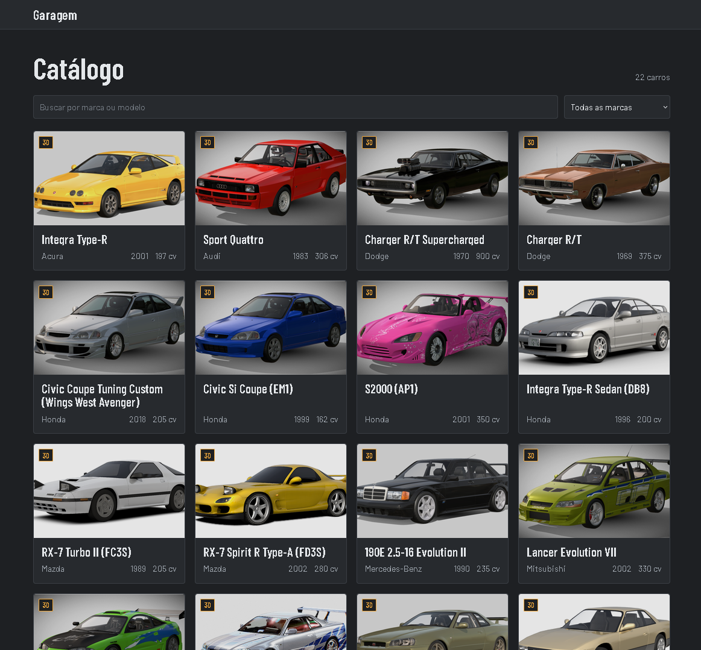
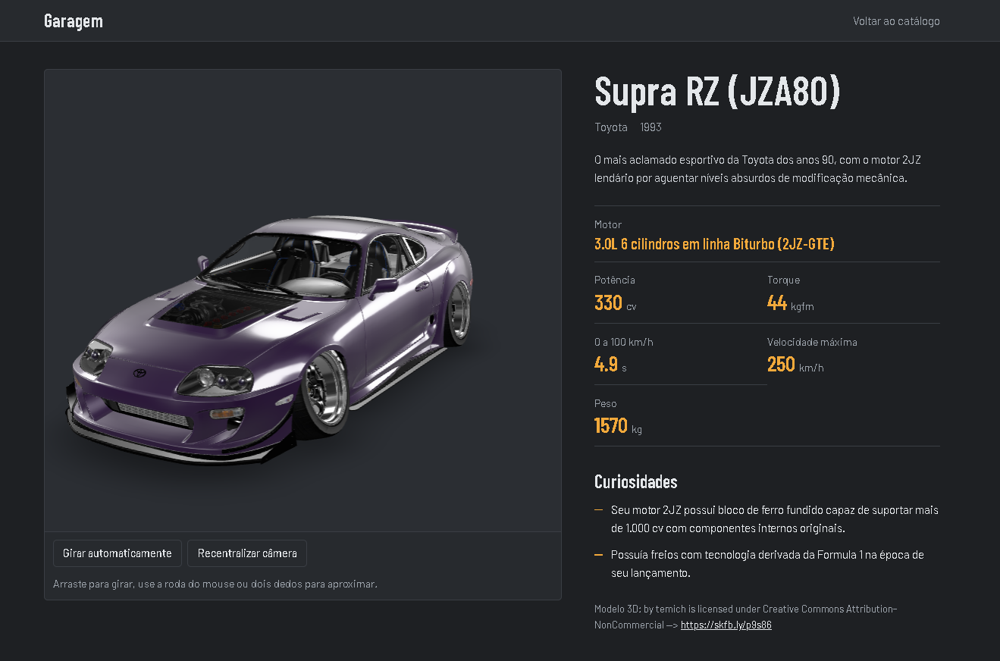

# Garagem

Catálogo de carros com modelo 3D animado, ficha técnica e curiosidades. Projeto da disciplina Linguagem de Programação para Web.

**Site:** https://garagem-jevtx.netlify.app






## O que o projeto faz

- **Catálogo** com busca por marca ou modelo e filtro por marca.
- **Página de detalhes** com o modelo 3D do carro (texturas e animações do próprio arquivo), controles de giro e câmera, ficha técnica, curiosidades e crédito do autor do modelo.
- **Realidade aumentada** em celulares compatíveis, pelo botão "Ver no seu ambiente".
- **Área de administração** com login, onde é possível cadastrar, editar e excluir carros.

## Tecnologias

| Parte | Ferramenta |
|---|---|
| Front-end | HTML, CSS e JavaScript puro (módulos ES), sem framework |
| Modelo 3D | [`<model-viewer>`](https://modelviewer.dev) (Google) com arquivos `.glb` |
| Banco de dados | Firebase Firestore |
| Login | Firebase Authentication (e-mail e senha) |
| Hospedagem | Netlify, com deploy automático a cada push na branch `main` |
| Versionamento | Git e GitHub |

## CRUD

As operações de banco ficam em [`js/carros.js`](js/carros.js):

| Operação | SQL equivalente | Função |
|---|---|---|
| SELECT | `SELECT * FROM carros ORDER BY marca` | `listarCarros()` |
| SELECT | `SELECT * FROM carros WHERE id = ?` | `buscarCarro(id)` |
| INSERT INTO | `INSERT INTO carros (...) VALUES (...)` | `inserirCarro(dados)` |
| UPDATE | `UPDATE carros SET ... WHERE id = ?` | `atualizarCarro(id, dados)` |
| DELETE | `DELETE FROM carros WHERE id = ?` | `excluirCarro(id)` |

## Segurança

- Qualquer visitante pode **ler** o catálogo, mas só a conta de administrador pode **gravar**. As regras do Firestore também validam os campos e os tamanhos dos dados.
- A configuração do Firebase no `js/firebase.js` é pública por natureza (identifica o projeto). A chave é restrita por domínio e por API no Google Cloud.
- Nenhuma senha, token ou credencial de conta de serviço está no repositório.
- O texto vindo do banco é sempre escapado antes de ir para a página.

## Estrutura

```
index.html        catálogo
carro.html        detalhes com o modelo 3D
admin.html        cadastro, edição e exclusão (com login)
404.html          página de erro
css/style.css
js/               firebase.js, carros.js, catalogo.js, detalhe.js, admin.js
assets/models/    arquivos .glb
assets/img/       imagens de prévia
netlify.toml      cabeçalhos de segurança e cache
```

## Rodar localmente

1. Use a extensão Live Server do VS Code ou rode `python -m http.server 8000` na pasta do projeto. Abrir os arquivos com duplo clique não funciona, por causa dos módulos JavaScript.
2. Para usar o seu próprio banco, crie um projeto no Firebase (Firestore e Authentication com e-mail e senha), troque os valores de `js/firebase.js` e publique regras que permitam leitura pública e escrita só para o seu usuário.
3. Adicione o endereço local (por exemplo `http://127.0.0.1:5500/*`) à lista de sites permitidos da chave de API, se ela estiver restrita.

## Limitações conhecidas

- Ao compartilhar o link de um carro específico, a pré-visualização mostra a imagem genérica do site, porque o conteúdo vem do banco e os mensageiros não executam JavaScript.
- Os modelos ficam no repositório, e o plano gratuito do Netlify limita o tráfego mensal. Por isso os arquivos `.glb` são mantidos o mais leves possível.

## Créditos

Cada modelo 3D é de autoria de terceiros, com licença Creative Commons. O autor, a licença e o link aparecem na página de cada carro.
